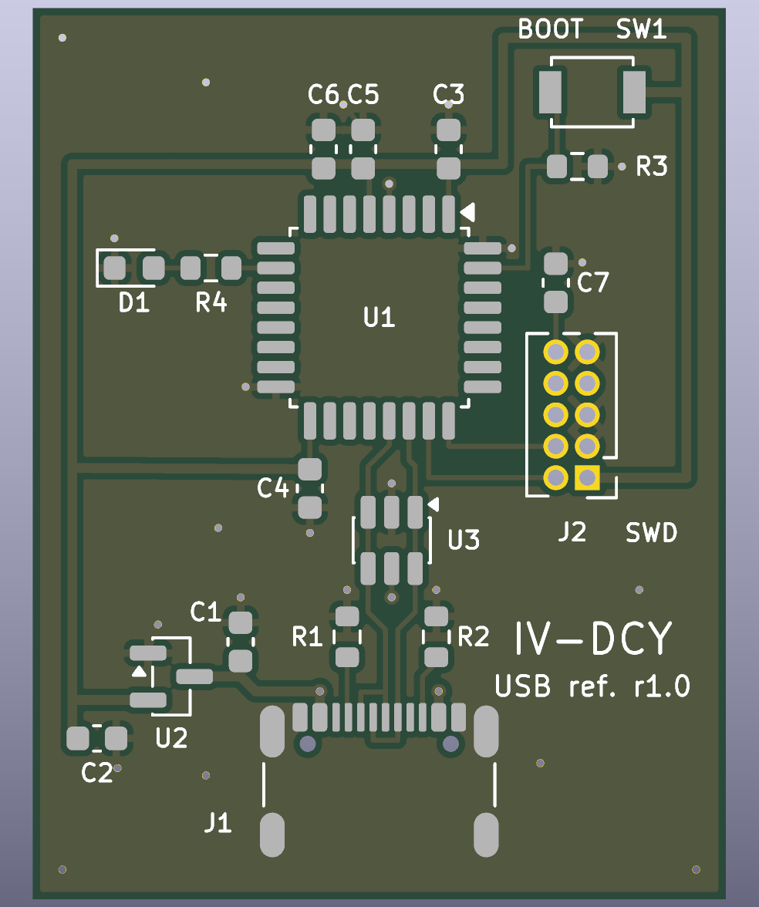

# IV-DCY USB reference board

IV-DCY is a small open-source USB device: a two-layer STM32F042 board and its
firmware. The board enumerates as a USB CDC-ACM serial port and answers a few
text commands (`PING`, `VERSION`, `INFO`, ...).

This project is the public reference implementation of the IV-DCY USB
identity: the vendor/product ID, the descriptors and the CDC-ACM command
interface. **It is not a measurement instrument.** The board has no
current–voltage (I–V) or other measurement hardware, and the firmware has no
measurement, calibration or instrument-control code. Everything here is a
complete, minimal USB device in its own right.

| | |
|---|---|
| USB ID | VID `0x1209` (pid.codes), PID `0x6767`: the PID this project will request from pid.codes. **Not yet assigned.** |
| USB function | USB 2.0 full speed, one CDC-ACM interface (virtual serial port), bus powered |
| MCU | STMicroelectronics STM32F042K6T6 (Cortex-M0, 48 MHz, 32 KiB flash, 6 KiB RAM, crystal-less USB) |
| Board | 28 × 36 mm, 2 layers, 18 components, USB-C |
| Licences | hardware CERN-OHL-S-2.0, firmware/software MIT (see [Licensing](#licensing)) |
| Status | Designed and checked in software only. **Not yet fabricated or tested on hardware**; see [docs/verification.md](docs/verification.md). |



## What the hardware does

The board is a bus-powered USB device with nothing on it but what a USB
device needs:

| Ref | Part | Purpose |
|---|---|---|
| J1 | GCT USB4105-GF-A USB-C receptacle (USB 2.0) | USB connection. The 5.1 kΩ R1/R2 on CC1/CC2 identify the board as a USB-C sink, so hosts supply 5 V. |
| U3 | ST USBLC6-2SC6 | ESD protection on D+/D− (flow-through layout), referenced to VBUS |
| U2, C1, C2 | Microchip MCP1700-3.3 LDO, 1 µF / 4.7 µF | 3.3 V from VBUS |
| U1, C3–C7 | ST STM32F042K6T6 + decoupling and NRST capacitor | USB full-speed device with on-chip D+ pull-up. Its 48 MHz RC oscillator is trimmed to the USB frame clock, so no crystal is needed. |
| SW1, R3 | BOOT push-button, 10 kΩ pull-down on PB8/BOOT0 | Held while plugging in: starts ST's USB DFU bootloader in ROM. Afterwards it is readable as a button. |
| D1, R4 | green LED on PA4 | status |
| J2 | ARM Cortex 10-pin 1.27 mm header | SWD programming/debugging |

Schematic: [hardware/docs/iv_dcy-schematic.pdf](hardware/docs/iv_dcy-schematic.pdf).
BOM: [hardware/bom/iv_dcy-bom.csv](hardware/bom/iv_dcy-bom.csv).
Design notes: [hardware/README.md](hardware/README.md).

## What the firmware does

The firmware sets up the 48 MHz clock and USB, then runs the TinyUSB device
stack. It enumerates as a CDC-ACM serial port and replies to line-based
commands:

| Command | Reply |
|---|---|
| `PING` | `PONG` |
| `VERSION` | firmware version, e.g. `0.1.0` |
| `INFO` | `IV-DCY USB reference fw=0.1.0 vid=0x1209 pid=0x6767 serial=<24 hex digits>` |
| `LED ON` / `LED OFF` / `LED AUTO` | `OK` (AUTO: LED shows the USB state) |
| `BUTTON` | `PRESSED` or `RELEASED` |
| `HELP` | list of commands |

The full descriptor and protocol description is in
[docs/usb-interface.md](docs/usb-interface.md). The firmware is about 11 KiB.
Build, test and flashing details are in [firmware/README.md](firmware/README.md).

## Repository layout

```
hardware/            board design (CERN-OHL-S-2.0)
  skidl/             circuit source (SKiDL) + schematic writer
  layout/            PCB placement and routing source (KiCad pcbnew script)
  kicad/             generated, editable KiCad 9 project: .kicad_sch, .kicad_pcb, .net
  bom/ fab/ docs/    BOM, Gerbers + drill + pick-and-place, schematic PDF, renders
  reports/           ERC and DRC reports of the committed design
  scripts/           netlist comparison and packaging helpers
  build.sh           regenerate everything and run all checks
firmware/            STM32F042 firmware (MIT)
  src/               application, board support, USB descriptors, start-up, linker script
  tests/             host unit tests (CTest)
  tools/             iv_dcy_check.py: host-side test over the serial port
docs/                USB interface, verification status, third-party components
LICENSES/            licence texts
```

## Building the hardware

You need KiCad 9 (with `kicad-cli` and its `pcbnew` Python module) and SKiDL 2.2.3.

```bash
python3 -m venv --system-site-packages .venv
```

```bash
.venv/bin/pip install -r hardware/requirements.txt
```

```bash
PYTHON=.venv/bin/python hardware/build.sh
```

`build.sh` regenerates the netlist and schematic from `hardware/skidl/iv_dcy.py`
and runs KiCad ERC. It then checks that the schematic's netlist equals the
SKiDL netlist, and rebuilds the routed PCB from `hardware/layout/place_route.py`.
Next it runs KiCad DRC, including schematic-parity checking, and stops on any
error or warning. Finally it writes the BOM, Gerbers, drill and position files.
The KiCad files in `hardware/kicad/` can also be opened and edited directly in
KiCad 9. See [hardware/README.md](hardware/README.md).

## Building and flashing the firmware

You need CMake ≥ 3.24, `arm-none-eabi-gcc` and git. The pinned dependencies
(TinyUSB, CMSIS) are fetched automatically at configure time.

```bash
cmake -S firmware -B build/firmware
```

```bash
cmake --build build/firmware
```

To flash over USB without a programmer, hold **BOOT**, plug the board in,
release the button, then run:

```bash
dfu-util -a 0 -s 0x08000000:leave -D build/firmware/iv_dcy.bin
```

To flash over SWD (ST-LINK, CMSIS-DAP, ...) via J2 with OpenOCD:

```bash
openocd -f interface/stlink.cfg -f target/stm32f0x.cfg -c "program build/firmware/iv_dcy.elf verify reset exit"
```

Host unit tests:

```bash
cmake -S firmware/tests -B build/tests && cmake --build build/tests && ctest --test-dir build/tests
```

## Talking to the device

The board appears as `/dev/ttyACM*` (Linux), `/dev/cu.usbmodem*` (macOS) or a
`COM` port (Windows 10 and later use the built-in `usbser` driver). Any
terminal works; the baud rate is ignored. Commands end with Enter and the
device does not echo. To run the scripted check:

```bash
pip install pyserial && python3 firmware/tools/iv_dcy_check.py
```

## Changing the VID/PID

The USB identity is defined in exactly one place,
[`firmware/src/usb_identity.h`](firmware/src/usb_identity.h): `USB_VID`,
`USB_PID`, the descriptor strings and the firmware version. The descriptors,
the `INFO` reply and `tools/iv_dcy_check.py` all read it. A unit test fails if
the VID or PID literal appears in any other firmware source. Until pid.codes
has assigned the PID, set `USB_PID` to the pid.codes test PID `0x0001` for any
board that leaves your own desk.

## Testing status

Everything that can be checked without hardware has been checked: ERC, DRC,
schematic/netlist parity, a clean firmware build, unit tests of the
descriptors and command parser, and an inspection of the linked image. **No
board has been built yet.** USB enumeration, the bootloader entry, the LED,
the button and the power supply have not been observed on real hardware, and
no USB-IF compliance testing has been done. The full list is in
[docs/verification.md](docs/verification.md).

## Licensing

| What | Licence |
|---|---|
| `hardware/` (circuit source, layout source, KiCad files, generated outputs, hardware scripts) | [CERN-OHL-S-2.0](LICENSES/CERN-OHL-S-2.0.txt) |
| `firmware/`, `docs/` and the top-level files | [MIT](LICENSES/MIT.txt) |

Third-party components are not relicensed; they keep their own licences.
TinyUSB is MIT and CMSIS is Apache-2.0; both are fetched at build time and not
stored here. The KiCad symbols and footprints are CC-BY-SA-4.0 with the KiCad
library exception. Details and redistribution notes are in
[docs/third-party.md](docs/third-party.md).

Copyright (c) 2026 Lucas Wu.
